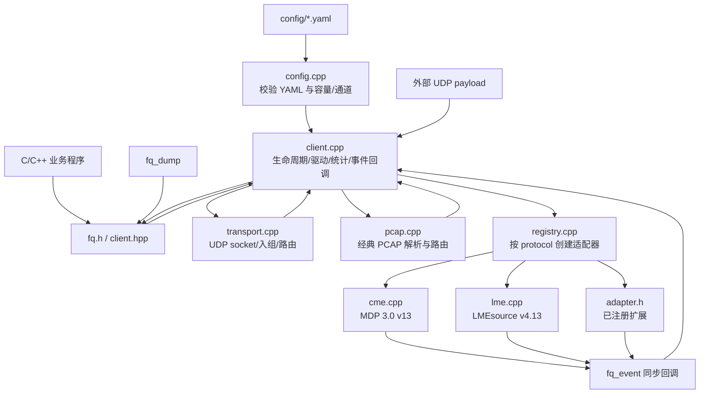
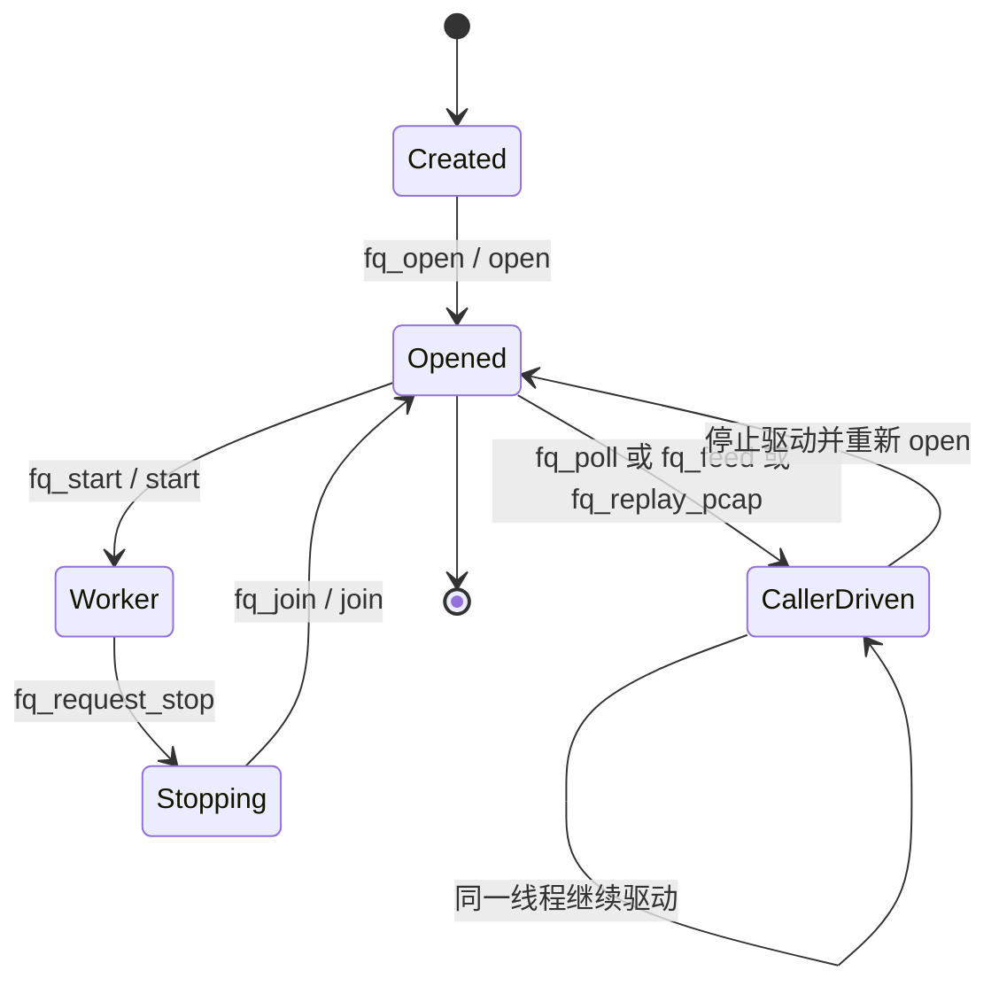
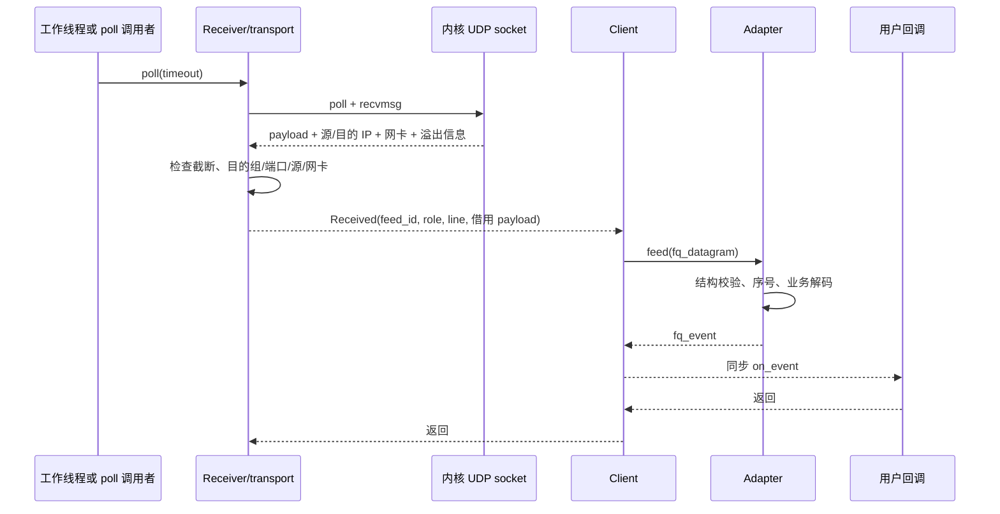
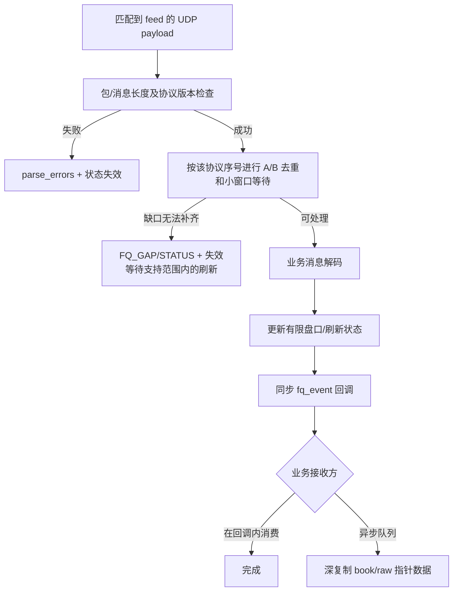

# 行情接入架构与数据流程

本文解释当前实现的模块关系与状态边界。项目仅用于测试环境；对完整订单簿、断线历史补全和自动重连没有生产级保证。使用步骤见 [总指南](market-data-guide.zh-CN.md)，公共字段见 [API 契约](api.md)，交易所字段见 [CME](cme.md) 和 [LME](lme.md)。

## 1. 模块职责

| 模块 | 输入 | 负责的工作 | 不负责的工作 |
|---|---|---|---|
| `config.cpp` | YAML 文件 | 拒绝未知字段和不支持的内置协议版本；建立 feed、端点、订阅及容量配置 | 不测试网络、官方地址是否仍有效 |
| `transport.cpp` | 配置的 IPv4 网卡与组播端点 | socket、ASM/SSM 加组、`poll`/`recvmsg`、目的组/端口/源/网卡路由、内核丢包和截断诊断 | 不解析 CME/LME 消息，不创建线程，不修改系统网络配置 |
| `pcap.cpp` | 经典 PCAP | 从支持的链路封装抽取 UDP payload，按同一 endpoint 规则选 feed/role/line | 不模拟录制时的到包间隔，不支持 PCAPNG 或 IP 分片重组 |
| `client.cpp` | 网络或调用方输入 | Client 生命周期、驱动互斥、feed 分发、同步回调、错误与统计 | 不理解具体模板 ID、MsgType 或盘口动作 |
| `registry.cpp` | `protocol` 与 `FeedConfig` | 创建 CME、LME 或提前注册的扩展 Adapter | 不在运行中自动加载新协议或插件文件 |
| `cme.cpp` | 一份 CME UDP payload 与 role | v13 结构校验、包序号、A/B、部分业务模板、有限 MBP 状态和快照衔接 | 不实现完整 MBO、TCP 历史补包或所有 v13 模板 |
| `lme.cpp` | 一份 LME UDP payload 与 role | 公共拆包、消息级序号、307/112/614 三类业务和有限刷新状态 | 不支持 v4.18、115 合约定义、RTS/TCP 补包 |
| `fq.h` / `client.hpp` | 业务调用 | 固定 C ABI 与 C++11 RAII 包装；统一事件输出 | 不延长回调数据生命周期，不提供异步事件队列 |

`config.cpp` 只在 `open` / `check_config` 阶段运行，热路径不重新解析 YAML。普通构建使用仓库已有的 CME SBE 生成头文件，运行时不读取 XML。`Cme` 和 LME 业务类在各自协议文件内持有状态；公共模块不尝试用同一序号/水位算法处理两家交易所。

## 2. 启动与线程所有权

图中的 `Created` 表示 `fq_create` 或 `fq::Client` 构造完成；从 `Opened` 结束表示调用 `fq_destroy` 或 C++ 析构。

`open` 构造适配器并预分配有限缓存，不创建 UDP socket。`start` 先创建 Receiver 并加组，再建立一个工作线程，在循环内反复调用 `poll_once(2)`；回调在该线程同步执行。`poll` 由调用线程驱动，第一次调用才按需建立 Receiver；一次调用完成就绪 socket 的收包及各适配器的计时处理，回调也在调用线程执行。`fq_dump` 使用 `poll(2)` 循环。`feed` 接外部 UDP payload，`replay_pcap` 读经典 PCAP，这两种测试/接入入口也由调用线程同步执行。

同一 Client 只能有一个驱动所有者。`start` 与 `poll/feed/replay` 互斥；`poll/feed/replay` 也不能并发或递归。`request_stop` 可以由其他线程或回调发出，但 `join` 和销毁必须在回调外完成。Client 的状态属于该实例，多 Client 之间不共享序号、缓存或盘口。实际调用示例见 [总指南的 Client 章节](market-data-guide.zh-CN.md#6-client-接入方式)。

## 3. 收包与路由

Receiver 按**目的 UDP 端口**复用 socket，`SO_REUSEADDR` 后绑定 `INADDR_ANY:port`，对每条 endpoint 在指定本机网卡上做 ASM (`IP_ADD_MEMBERSHIP`) 或 SSM (`IP_ADD_SOURCE_MEMBERSHIP`) 加组。Linux 使用 `IP_MULTICAST_ALL=0` 和 `IP_PKTINFO`；macOS 使用相应目的地址和网卡辅助信息。`recvmsg` 得到的数据必须同时匹配目的组、端口、可选源和网卡，才映射为 `feed_id + role + line`。因此同端口上的增量、快照和定义不会只凭端口混派。

实现使用每个 socket 至多 `receive_batch_max` 次非阻塞 `recvmsg`，不是 `recvmmsg` 或硬件旁路。接收器复用一块 64 KiB 缓冲：`Received.data` 以及随后构造的 `fq_datagram.data` 只借用到同步处理返回前。截断的 payload 或控制信息不派发；Linux 的 `SO_RXQ_OVFL` 提供内核队列溢出差值。`datagrams` 在包**匹配到已知 feed 并进入 Client**后增加；因此 `tcpdump` 有包但 `datagrams=0` 可能发生在内核交付或 Receiver 路由之前。详细配置及现场排查见 [配置](configuration.md) 与 [离线联调](offline-centos7.md)。

## 4. 解码、状态与错误

CME 将 UDP 包头 `MsgSeqNum` 作为**包序号**。包可容纳多条 SBE 消息，结构校验按固定 schema v13；A/B 重复包不会重复发布。LME 包头的 `SeqNum` 是**包内第一条消息序号**；A/B 包可部分重叠，须逐消息去重。LME 刷新通道和实时通道分开维护序号；112 的 612 水位用于衔接 112 实时缓存，614 又有独立序号。跨协议、feed、epoch、消息种类比较序号都可能错误。

两个适配器都只保留有限的乱序等待和恢复缓存，缓存大小由配置控制。CME 在合约定义、52 MBP 快照与缓存增量满足条件后发布有效盘口；LME 112 在完整 612 刷新周期和 112 连续增量衔接后发布有效盘口。已恢复的盘口不证明中断期间的全部成交或统计已补全。坏包和接收丢包会导致状态失效；业务语义错误可能在同一 UDP 包先前消息已经回调后才发现，不保证整包业务事件可回滚。用户应消费 `FQ_STATUS`、`FQ_GAP` 与各有效位，并自行定义新鲜度和补数策略。

`fq_event` 是统一信封，`type` 选择 union 成员。`FQ_BOOK` 档位指针、`FQ_RAW_MESSAGE` 字节指针和事件本身只在回调期间有效。`fq_dump` 为异步打印做深复制并单独计数采样/队列溢出；这只是测试工具行为，不改变库的同步回调契约。终端打印速度不是解码延时指标。

## 5. 扩展边界

新增交易所若仍为 UDP payload，可在 `fq_open` 前通过 [`adapter.h`](../include/futures_quote/adapter.h) 注册协议适配器，复用配置、Transport、Client 和统一事件；特有 framing、序号、恢复与业务语义留在适配器内。外部 TCP/SDK/共享内存输入可先由调用方转换成完整 payload 并调用 `fq_feed`；让 Client 自行管理新会话则需新增传输层。扩展步骤、C ABI 注册契约和验收要点见 [扩展文档](extending.md)。

协议扩展必须以对应环境的交易所官方规范为依据，记录版本、来源、核对日期和 SHA256。修改 schema 时同步生成代码、字段说明和回归样本；不能借现场组播配置改写交易所报文布局，也不能把“生成了访问器”当作已经实现业务解码。
