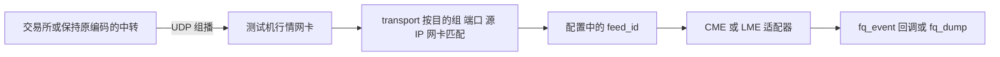
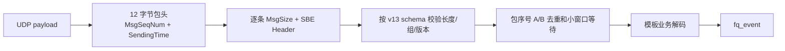
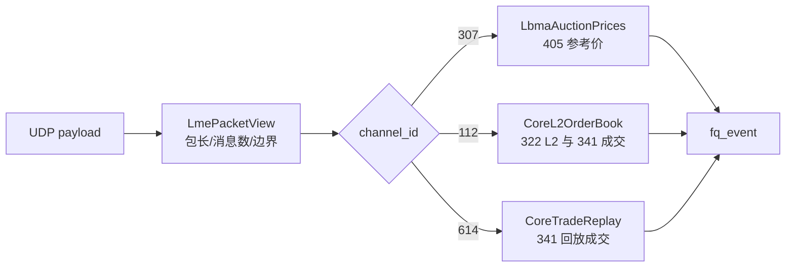
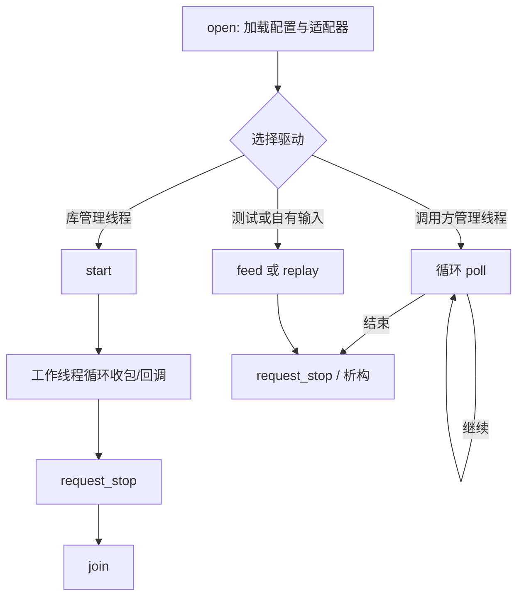

# CME / LME 行情接入与解码指南

> **声明：本项目和本文档仅供测试环境中的行情接入、报文解码和接口联调。请勿用于生产环境。** 本项目没有完成交易所认证、生产网络验收或完整的行情恢复验证；本文档也不能替代交易所现行规范、接入授权和现场网络资料。

本文面向需要在测试机上接收 CME MDP 3.0 或 LMEsource v4 组播，并将解码结果接入 C/C++ 程序的开发人员。项目重点是**配置组播、接收 UDP payload、按固定协议版本解码并输出统一事件**。代码含**有限的** A/B 去重、盘口状态和快照衔接逻辑；它们只服务于当前已实现的消息范围。若业务需要完整订单簿、断线后历史行情补全、严格的快照加增量恢复、自动重连或可用性保证，请根据交易所现行规范自行实现并验证，不要把本项目的 `FQ_BOOK_VALID` 或 `FQ_RECOVERED` 当作生产级恢复承诺。

## 阅读顺序

1. [准备环境和核对版本](#1-准备环境和核对版本)：先确认数据来源、网卡、协议和官方文件。
2. [编译与首次验证](#2-编译与首次验证)：本地或离线测试机安装、运行。
3. [配置组播与订阅](#3-配置组播与订阅)：区分通道、端点、线路和合约。
4. [CME](#4-cme-mdp-30) / [LME](#5-lmesource-v4)：已实现通道、报文与代码路径。
5. [Client 接入](#6-client-接入方式)：两种驱动模式、回调与生命周期。
6. [验证与排障](#7-验证与排障)：识别网络、解码和业务状态问题。

具体实现见 [架构与流程](architecture.md)、[配置字段](configuration.md)、[CME 解码](cme.md)、[LME 解码](lme.md)、[API 契约](api.md)。这些模块文档解释细节；本指南给出完整的接入路径。文中带版本的地址和示例均为**测试配置样例**，实际接入参数以现场环境为准。

## 1. 准备环境和核对版本

### 1.1 先确认数据与网络

向测试环境接入方确认：可接入的行情环境、授权范围、逻辑 Channel ID、每个流的目的组播 IP/UDP 端口、A/B 线路、是否要求 SSM、实际到达本机的 UDP 源 IP、接收网卡及其本机 IPv4。若数据经供应商转发，还须确认**UDP payload 仍是交易所官方原生编码**；组播地址和源 IP 可以因中转变化，但不能据此改变消息布局或将私有编码交给本项目解码。



`group` 是包的**目的**组播地址，`port` 是目的 UDP 端口；`source_ip` 是可选的**发包源**限制；`network.interface_ip` 是**本机收包网卡**的 IPv4。一个逻辑通道通常有增量、快照/刷新、合约定义等不同流，A/B 则是同一流的冗余线路。应用侧 `feed.id` 用来选择适配器，`channel_id` 是交易所逻辑通道；两者即使写成相同数字，含义也不同。`subscriptions` 只过滤业务输出，不能让交易所只发送某个合约，也不能减少底层整通道的序号处理。

Linux 测试机可先只读检查：

```sh
ip -4 addr show
ip -4 route
sudo tcpdump -ni <行情网卡> -c 5 'udp and dst host <目的组播IP> and dst port <端口>'
```

`tcpdump` 能见包只证明链路到达抓包点，不能证明内核已把包交给 UDP socket。项目不修改路由、IGMP、`rp_filter`、防火墙或交换机配置；这些由测试环境网络管理员核实。网络排查案例见 [CentOS 7 离线联调](offline-centos7.md#6-tcpdump-有组播包但-datagrams0)。

### 1.2 固定实现基线与官方更新

| 协议 | 当前代码接受的配置 | 项目依据与核对记录 | 接入前要复核的官方入口 |
|---|---|---|---|
| CME MDP 3.0 Core SBE | `protocol: cme_mdp3`、`revision: "13"`，schemaId=1/version=13 | `schemas/cme/templates_v13.xml`，SHA256 `f45ebadf65ccb1a2d416f00ee755480072ecff030970cc170a78540541d78d60`； | [Production Templates](https://www.cmegroup.com/ftp/SBEFix/Production/Templates/)、[Production Configuration](https://www.cmegroup.com/ftp/SBEFix/Production/Configuration/)、[Message Schema](https://cmegroupclientsite.atlassian.net/wiki/spaces/EPICSANDBOX/pages/457225459/MDP-30---Message-Schema)、[Message Specification](https://cmegroupclientsite.atlassian.net/wiki/spaces/EPICSANDBOX/pages/457323107/MDP%2B3.0%2B-%2BMessage%2BSpecification) |
| LMEsource v4 | `protocol: lmesource_v4`、`revision: "4.13"` | 本地官方 *Client Interface Specification v4.13*，SHA256 `5af7c2860d3bf7f16e0766924ab6b8a1e18394a3c72c531f5a67a42020cbf0f7`；2026-10-19 按该版本核对部分已实现字段 | [LMEsource 文档页](https://www.lme.com/Trading/Systems/LMEsource)、[当前 Client Interface Specification v4.18](https://www.lme.com/-/media/files/trading/systems/lmesource/lmesource-client-interface-specification-v4-18.pdf)、[Developer Guide v1.1](https://www.lme.com/-/media/files/trading/systems/lmesource/lmesource-v4-developer-guide-v11.pdf) |

**更新重点：**2026-10-20 查看 LME 官网时，已发布 v4.18；其版本记录说明 v4.17 移除了 Reference Auction Price (405)。本项目的 307/807 解码以旧版 v4.13 的 405 为前提，**不能宣称与 v4.18 或当前 LME 生产流兼容**。请先确认测试环境实际发布的协议版本、通道和消息；若为新版，不要仅把 YAML 的 `revision` 改成新数字，应核对官方正文并修改适配器、样本和文档。LME 组播表来自 *LME Systems Connectivity Guide v5.4*（SHA256 `b0900eefb11363a8b5e0842774344342c1998c40faaf2503ab4c1da06e2bfa4b`，2026-10-19 核对）；当前连接参数仍须向测试环境确认，官网入口见 [LME Systems](https://www.lme.com/Trading/Systems)。

CME 的 `config.xml` 是**连接配置**，包含通道、组播和源地址；`templates_FixBinary.xml` / `templates_v13.xml` 是**消息布局 schema**。请分别复核，不能用组播地址推断 schema 版本，也不能把 CME New Release、iLink、Streamlined SBE 的版本当成本项目 MDP 3.0 生产版本。核对官方原文时记录下载环境、版本、日期与 SHA256；文件名或目录修改时间不是内容一致的证明。[官方 Channel Guide](https://cmegroupclientsite.atlassian.net/wiki/spaces/EPICSANDBOX/pages/457323048/MDP%2B3.0%2B-%2BCME%2BGlobex%2BMarket%2BData%2BChannel%2BGuide)和[恢复说明](https://cmegroupclientsite.atlassian.net/wiki/spaces/EPICSANDBOX/pages/457419188/MDP%2B3.0%2B-%2BRecovery)也应在测试前复核。

### 1.3 离线 SBE 生成与构建依赖

普通构建**不运行代码生成器**：仓库已带 CME v13 XML、`generated/cme/fq_sbe/` 访问器和 `generated/cme/cme_layout.hpp`。测试机无外网时，直接使用随包生成代码。只有核对新官方 schema、确认需更新后，才在**有 JRE/JDK 17+ 的开发机**准备固定的 `sbe-all-1.35.0.jar` 并重新生成；`tools/generate_sbe.sh` 会校验 jar SHA256，生成 C++ 访问器，再执行 GCC 4.8 兼容转换与本项目的布局表生成。此过程不应在无外网测试机上临时下载依赖。

```sh
shasum -a 256 schemas/cme/templates_v13.xml
SBE_JAR=/path/to/sbe-all-1.35.0.jar ./tools/generate_sbe.sh
python3 tools/check_cme_schema.py --official-file /path/to/已核验的官方生产XML
```

示例中的 `/path/to/...` 需要替换。**生成只解决字段访问，并不自动实现业务模板、恢复语义或兼容新协议。** 若官方 schema 与项目不同，先审阅类型、偏移、blockLength、重复组、null、模板 ID 和 `sinceVersion`，同步更新生成代码、业务解码、字段文档与回归样本后再测试。固定依赖及校验值见 [THIRD_PARTY.md](../THIRD_PARTY.md) 和 [CME schema 核验记录](cme-schema-verification.md)。LME 当前为按官方字段表手工解码，不使用 SBE 生成器。

## 2. 编译与首次验证

### 2.1 本地 CMake

需要 C++11 编译器、CMake ≥ 3.16、POSIX 平台。构建生成动态库、静态库、`fq_dump` 和测试程序；yaml-cpp 源码已放在 `third_party/`，

```sh
cmake -S . -B build -DCMAKE_BUILD_TYPE=Release
cmake --build build --parallel 4
ctest --test-dir build --output-on-failure
python3 tools/make_demo.py build/demo.pcap
./build/fq_dump --config config/replay.yaml --pcap build/demo.pcap --rate 0
```

`demo.pcap` 是项目构造的演示数据，用于验证解码链路，不是交易所真实录包。`--pcap` 读取经典 PCAP，按文件顺序尽快回放，不模拟报文间隔；支持范围见 [PCAP 说明](configuration.md#命令与排障)。

要在另一个 C/C++ 项目中链接本库，可先 `cmake --install build --prefix "$PWD/build/install"`，然后在调用方 CMake 中使用：

```cmake
find_package(futures_quote CONFIG REQUIRED)
target_link_libraries(my_app PRIVATE futures_quote::shared)
# 或改用 futures_quote::static
```

调用方配置时传入 `-DCMAKE_PREFIX_PATH=/path/to/futures_quote/build/install`。动态库需要对应平台的 C++ 运行库；静态 `.a` 仍需用 C++ 链接器和线程库链接，不代表最终程序完全静态化。C API 见 [`fq.h`](../include/futures_quote/fq.h)，C++ 包装见 [`client.hpp`](../include/futures_quote/client.hpp)。

### 2.2 CentOS 7 / GCC 4.8.5 无外网测试机

本地执行 `./scripts/package.sh output`，将 `output/futures_quote-offline.tar.gz`、对应 `.sha256` 和 `output/unpack.sh` 一起上传到服务器同一目录。服务器执行：

```sh
./unpack.sh
cd futures_quote
./scripts/build.sh
cp config/cme-382-384-test.yaml config/local.yaml
# 编辑 config/local.yaml：先填本机 interface_ip，再核实各 endpoint
./scripts/run.sh --check
./scripts/run.sh --duration 60 --rate 20 --trace
```

`build.sh` 直接用本机 `g++` 和 `ar`，不调用 yum、curl、git 或 CMake；包含本地测试。`--check` 只检查配置和适配器创建，**不会加入组播，也不验证网络可达**。离线包的详细升级和诊断步骤见 [离线联调文档](offline-centos7.md)。`config/local*.yaml` 保存现场 IP，应留在测试机，不应提交到仓库。

## 3. 配置组播与订阅

一个配置文件可包含多个 feed；当前所有 feed 共用 `network.interface_ip`。不同物理网卡需要分别创建 Client。测试时建议先不加 `subscriptions`，确认收包及协议解码后再缩小业务输出。

```yaml
config_version: 1
network:
  interface_ip: 192.0.2.10   # 示例；改为本机实际行情网卡 IPv4
  receive_buffer_bytes: 16777216
  receive_batch_max: 16
feeds:
  - id: 382                 # 应用内部 feed_id
    protocol: cme_mdp3
    revision: "13"
    channel_id: 382          # 交易所逻辑通道
    depth: 10
    endpoints:
      - {role: incremental, line: A, group: 224.0.31.130, port: 14382}
      - {role: snapshot,    line: A, group: 224.0.31.151, port: 14382}
      - {role: definition,  line: A, group: 224.0.31.172, port: 14382}
```

上面三个地址来自项目保存的**历史** CME 配置，仅用于解释一条通道的三类流；测试现场须复核。`source_ip` 可省略，省略时按 ASM 加组；若现场要求 SSM，则为每条 endpoint 添加**实际发包源** `source_ip`。CME 382/384、LME 112/612/614、LME 307/807 的现成模板分别在 [`config/cme-382-384-test.yaml`](../config/cme-382-384-test.yaml)、[`config/lme-112-612-614-test.yaml`](../config/lme-112-612-614-test.yaml)、[`config/lme-307-807-test.yaml`](../config/lme-307-807-test.yaml)。模板中的 Production 地址不能直接证明测试网可达；尤其 `REPLACE_WITH_*` 必须填实际值，或在确认 ASM 后删掉源地址占位项。

| 字段或角色 | 作用 | 常见误用 |
|---|---|---|
| `interface_ip` | 本机收到组播的网卡 IPv4 | 填成 `224.*` 组播或上游发包 IP |
| `group` + `port` | UDP 包的目的组与目的端口 | 把逻辑 Channel ID 当端口，或沿用另一环境的端口 |
| `source_ip` | 可选 SSM 源限制；每条流单独核实 | 把同一个源 IP 套用到所有增量/快照/定义流 |
| `line: A/B` | 冗余线路；同一个 feed 内去重 | 把 A/B 拆成两个互不相关的行情状态 |
| `role` | `incremental`、`snapshot`、`definition`、`dr` | 把刷新或成交回放当作实时增量 |
| `subscriptions` | 按合约、symbol/group 或商品码过滤业务事件 | 以为它会减少网络订阅或跳过整通道解码 |

`fq_dump` 的 `--rate` 仅控制进入打印队列的普通事件量，SDK 仍接收和解码所有已配置数据。状态、缺口和交易状态尽量保留输出；`--rate 0` 不采样。`--trace` 是 `scripts/run.sh` 的选项，显示入组信息和前 20 个 UDP 收包结果；直接运行 `fq_dump` 时可设置 `FQ_TRACE_TRANSPORT=1`。完整 YAML 字段、容量和冲突规则见 [配置文档](configuration.md)。

## 4. CME MDP 3.0

### 4.1 通道与本项目范围

CME 的一个逻辑通道承载一组产品，网络上区分 Incremental、MBP Snapshot/Market Recovery 和 Instrument Replay/Definition。以保存的历史配置为例：360 为黄金、白银、铜等相关产品，382 为原油相关产品，384 为铂钯相关产品；准确产品分组和目的地址以测试环境文件为准，见 [通道解释](cme-multicast-channels.zh-CN.md)和 CME [官方 Channel Guide](https://cmegroupclientsite.atlassian.net/wiki/spaces/EPICSANDBOX/pages/457323048/MDP%2B3.0%2B-%2BCME%2BGlobex%2BMarket%2BData%2BChannel%2BGuide)。要看单个合约，先接收整个所属通道，再从模板 54/55/56 的定义取得 `SecurityID` 或 `Symbol`，用 `subscriptions.instrument_ids` / `symbols` 过滤输出。

当前 `src/cme.cpp` 的 `Cme` 适配器按固定 v13 解码；382 和 384 不各自拥有一份解码代码，而是由配置决定包进入哪个 feed 实例，**每个 feed 独立维护自己的序号、合约和盘口状态**。已实现的模板包括：4/12 控制消息；54/55/56 公共合约属性；46 四侧 MBP 更新及部分逐笔委托事件、47 委托事件、48 成交汇总；37/49/50/51 量与统计；30/39 状态或原始消息；52 MBP 快照。**MBO 完整订单簿和 53 MBO 快照没有实现**。其余 schema 模板即使有生成头文件，也不等于有业务适配；遇到未支持模板会解析失败并失效化状态。逐项以 [支持表](protocol-support.md) 和 [CME 解码细节](cme.md) 为准。

### 4.2 包、消息和状态



CME 的 `MsgSeqNum` 是**包序号**；一个包可含多条 SBE 消息。消息中的 `templateId` 决定布局，`blockLength` 仅表示根块长度，不能用它跳到下一条消息，必须按 `MsgSize` 移动。数字按 schema 的小端规则读取。`PRICE9` 以整数 mantissa 和 `10^-9` 表达，空值通过 `valid` 判断；不自动乘 `display_factor`。`FQ_BOOK_DELTA` 可能先于完整交易所事件结束；只有 `MatchEventIndicator.EndOfEvent` 结束后，才发布完成的 `FQ_BOOK`。`report_sequence` 是合约级 RptSeq，不能与包序号混用。

适配器会尝试利用 52 快照的水位和缓存增量恢复 MBP；若定义未就绪、缺口无法衔接、缓存覆盖或收到坏包，就不能认定盘口有效。`FQ_BOOK_VALID` 只说明适配器当前维护的 MBP 视图通过其有限条件；**不能证明丢失的成交、统计或订单历史已补全**。正式的恢复和建簿需求应按官方 [Book Management](https://cmegroupclientsite.atlassian.net/wiki/spaces/EPICSANDBOX/pages/457223312/MDP%2B3.0%2B-%2BBook%2BManagement) 与 [Recovery](https://cmegroupclientsite.atlassian.net/wiki/spaces/EPICSANDBOX/pages/457419188/MDP%2B3.0%2B-%2BRecovery) 自行实现和验收。

## 5. LMEsource v4

### 5.1 通道与本项目范围

LME 的 Realtime 与 Refresh 是**不同逻辑通道**，A/B 是各自的冗余线路。项目把 **112 实时 + 612 刷新**放进一个 `channel_id: 112` feed；**614** 是独立成交回放 feed；**307 实时 + 807 刷新**放进一个 `channel_id: 307` feed。307/807 属旧版 v4.13 的 LBMA 拍卖参考价路径，受上述 v4.18/405 变更影响。现成地址关系见 [LME 通道表](lme-production-channels.zh-CN.md)，但须以测试环境当前指南和抓包为准。111/611、113/613、115/615 没有对应内置业务解码器，**改 YAML 无法启用**；未接 115 合约定义时，112/614 主要使用 `TradableInstrumentID`，没有本项目提供的 symbol 映射。

### 5.2 包、消息和代码路径

LME v4.13 的包头为 16 字节：`PktSize:u16@0`、`MsgCount:u8@2`、`SeqNum:u32@4`、`SendTime:u64@8`。每条消息从 `MsgSize:u16`、`MsgType:u16` 开始。`SeqNum` 是包中**第一条消息**的序号，之后每条消息递增；A/B 包若只部分重叠，需逐消息去重，不能整包丢弃。`MsgCount=0` 为心跳，不消耗消息序号。更详细的字段、空值和消息表请看与**现场协议版本相符**的 [LME 官方规范](https://www.lme.com/Trading/Systems/LMEsource)，本项目实现说明见 [LME 解码文档](lme.md)。



`src/lme.cpp` 中的 `LmePacketView` 共用拆包和边界检查，`make_lmesource_adapter` 按 `channel_id` 选择业务适配器；三个类分别持有各自的实时/刷新序号与恢复水位。112 解码 311/312、320、322、327、329、341：包括交易状态、开盘指示价、15 档聚合盘口、清盘、询价和成交。322 的显式与隐含数量分别映射到四侧盘口。612 的两个 203 标记界定完整刷新周期，其 `LastSeqNum` 是**112 实时流水位**，不是 612 的消息号。614 只处理自己的刷新周期及 341 成交；回放成交标 `FQ_RECOVERED`，可能与 112 的实时 341 或下一轮 614 重复，消费方需按合约、MatchID 和取消标志做业务去重。307/807 解码旧版 405 参考拍卖价，它不是连续买卖盘口。

当前没有 LME RTS/TCP 补包，也不保证断线期间所有成交或状态能靠刷新找回。进入状态不明、缺口或刷新不完整时，应用不得继续把先前盘口视为新鲜。所有 LME 整数和价格尺度均以**当前配置锁定的 v4.13 文档**为准；新版规范需重新核对，不能照搬本节布局。

## 6. Client 接入方式

公共 C ABI 在 [`fq.h`](../include/futures_quote/fq.h)，C++11 RAII 包装在 [`client.hpp`](../include/futures_quote/client.hpp)。`open(config)` 读取 YAML、构造各 feed 适配器并预分配缓存，**不加组播**。启动有以下**两种互斥驱动方式**；选择依据是由谁持有收包循环。

| 生命周期步骤 | C++ 包装                       | C ABI                                    | 说明                       |
| ------ | ---------------------------- | ---------------------------------------- | ------------------------ |
| 创建     | `fq::Client` 构造              | `fq_create`                              | 注册同步回调及调用方拥有的 `user` 指针  |
| 加载配置   | `open(path)`                 | `fq_open`                                | 创建适配器；不建立接收 socket       |
| 库内线程驱动 | `start()`                    | `fq_start`                               | 加组并启动一个工作线程              |
| 调用方驱动  | `poll(ms)`                   | `fq_poll`                                | 第一次调用按需加组；后续逐次收包         |
| 停止与清理  | `request_stop()`、`join()`、析构 | `fq_request_stop`、`fq_join`、`fq_destroy` | 先请求停止，再在回调外等待；C++ 析构回收句柄 |

### 6.1 方式一：库内工作线程 `start`

`start()` 建立接收 socket、按配置加组，并启动**一个库内工作线程**循环收包、路由、解码与同步回调。业务线程可同时处理其他工作或查询累计统计。结束时先 `request_stop()`，再由非回调线程 `join()`；`join()` 会等线程退出并关闭接收器。`start()` 成功只代表本地启动成功，不代表收到包、完成同步或数据有效。

```cpp
#include <futures_quote/client.hpp>
#include <futures_quote/fq.h>
#include <chrono>
#include <thread>

static void on_event(void *, const fq_event *e) {
    if (e->type == FQ_BOOK && (e->flags & FQ_BOOK_VALID)) {
        if (e->data.book.counts[FQ_BID] > 0) {
            const fq_level &bid1 = e->data.book.sides[FQ_BID][0];
            // 在回调返回前使用或深复制；bid1.price.valid=0 时不能读取成价格 0。
            (void)bid1;
        }
    }
}

int main() {
    fq::Client client(on_event);
    client.open("config/local.yaml");
    client.start();
    // 这里只运行 30 秒；实际业务可等待自己的停止信号。
    std::this_thread::sleep_for(std::chrono::seconds(30));
    client.request_stop();
    client.join();
}
```

回调运行在库工作线程；不要在回调中做慢速终端打印、磁盘/网络 I/O 或等待主线程持有的锁，否则会阻塞收包。

### 6.2 方式二：调用方线程循环 `poll`

不调用 `start()`。`poll(timeout_ms)` 在**调用它的线程**创建接收器（首次调用）、等待一次网络事件、处理数据和超时，并在返回前同步执行本轮回调。业务程序自行控制循环、退出、线程归属和调度；`timeout_ms` 允许 0–1000 毫秒。`fq_dump` 的实时模式实际采用这种方式（每次 `poll(2)`），所以它不是 `start` 模式的线程示例。

```cpp
#include <futures_quote/client.hpp>
#include <chrono>

static void on_event(void *, const fq_event *e) {
    // 此回调由 poll 所在的调用线程同步执行。
    (void)e;
}

int main() {
    fq::Client client(on_event);
    client.open("config/local.yaml");
    const std::chrono::steady_clock::time_point deadline =
        std::chrono::steady_clock::now() + std::chrono::seconds(30);
    while (std::chrono::steady_clock::now() < deadline) {
        client.poll(2);  // 在当前线程收包、解码并执行回调
    }
    client.request_stop();
}
```

同一个 Client 必须由单一生命周期所有者协调 `open/start/poll/feed/replay/join`；**不能把 `start` 和 `poll` 同时用于同一实例，也不能并发或递归调用 `poll/feed/replay`**。若要隔离不同接收网卡或负载，可建立多个 Client，它们不共享适配器状态。`request_stop` 可由其他线程或回调调用，但回调中不得 `join`、销毁对象或递归驱动。

### 6.3 外部输入与回放

已有 UDP 收包框架可在调用方线程使用 `feed(fq_datagram)`。`data/size` **只包含 UDP payload**，不含 Ethernet/IP/UDP 头；`feed_id` 要匹配配置中的 `feeds[].id`，`role` 要对应源流，`line` 为 0(A)/1(B)，`receive_time_ns` 应使用一致的 Unix 纳秒时钟；输入缓冲区保持到 `feed` 返回即可。`replay(path)` 从经典 PCAP 读取并使用同一解码状态机，事件带 `FQ_REPLAYED`。回放遇到首个坏包停止；需要新会话时重新 `open`。PCAP/`feed` 可用于离线解码验证，不能代替真实组播接收验收。



### 6.4 回调、数值与错误

`fq_event`、`FQ_BOOK` 的档位指针和 `FQ_RAW_MESSAGE` 的字节指针只在**本次回调内**有效；放入异步队列必须深复制。价格为 `mantissa × 10^exponent`，先看 `valid`；数量、委托数、交易 ID 各有独立有效位。`FQ_BOOK_VALID`、`FQ_STREAM_CONTIGUOUS`、`FQ_RECOVERED`、`FQ_REPLAYED` 是相互独立的标志，不能从一个推断另一个。`sequence` 在 CME 是包序号，在 LME 是消息序号；`report_sequence` 才是 CME 合约级 RptSeq。跨 feed、跨 epoch、跨 LME 实时与刷新通道的序号不能比较。

C API 入口返回负错误码，`fq_last_error` 取诊断；C++ 包装将错误码转成异常。输入结构需先清零并填写 `struct_size`、`FQ_ABI_VERSION`。回调不得抛出跨 C 边界的异常；库会捕获并请求停止。`fq_get_statistics` 是 Client 生命周期累计值，`open` 不清零。详细的线程约束、事件字段和内存所有权见 [API 契约](api.md)。

## 7. 验证与排障

建议按“配置 → 入组 → 包 → 解码 → 业务有效性”逐层验证，而不是只看屏幕上有没有 `BOOK`。

| 观察结果                                      | 首先检查                                                              |
| ----------------------------------------- | ----------------------------------------------------------------- |
| `--check` 成功但没有行情                         | `--check` 不连网络；再跑短时实时接收，查看 `join` / `recv`、`datagrams` 和抓包        |
| `tcpdump` 有包、`datagrams=0`                | 组播是否交付 UDP socket、接收网卡/目的组/端口/SSM 源是否匹配；Linux 还应核查路由与 `rp_filter` |
| `datagrams>0` 且 `parse_errors>0`          | 报文是否真是配置的官方版本；检查 `fq_last_error`、role、完整报文长度和模板/消息类型              |
| 有增量或 `BOOK_DELTA`，没有有效 `BOOK`             | 可能缺合约定义、快照/刷新或缓存水位无法衔接；也可能尚未遇到完整事件边界                              |
| LME 只有 112，没有 614                         | 614 是独立回放流；检查其 endpoint 入组和到包，完整 203 周期与 341 成交是否出现               |
| 打印很少或 `sampled>0`                         | `--rate` 限制打印样本；SDK 解析计数仍可增长                                      |
| `socket_drops` / `truncated_datagrams` 增长 | 接收缓冲、现场速率、消费者处理时间和系统网络限制；状态可能已失效                                  |

示例命令：

```sh
./build/fq_dump --config config/local.yaml --check-config
FQ_TRACE_TRANSPORT=1 ./build/fq_dump --config config/local.yaml --duration 30 --rate 20
# CentOS 离线包则用：./scripts/run.sh --config config/local.yaml --duration 30 --rate 20 --trace
```

结尾 `datagrams` 是进入已知 feed 的包数，`parse_errors` 是适配器异常次数；`socket_drops` 在 Linux 依赖内核溢出计数，其他平台为 0 不代表绝无丢包。`fq_dump` 的 `sampled`、`print_queue_overflow` 是打印器计数，不是 SDK 解码事件数。正常短时测试仍可能因为休市、无成交或完整刷新尚未完成而没有某类业务事件；请结合包、状态和交易时段判断。**本项目当前只适合作为测试接入与解码基线，不能从一轮演示或本地单元测试推断生产可用性。**

## 8. 模块文档与官方入口

| 想进一步了解 | 项目文档 | 官方资料 |
|---|---|---|
| Client、Transport、Adapter 的职责和状态流 | [架构与流程](architecture.md)、[API 契约](api.md)、[配置字段](configuration.md) | — |
| CME 字段、模板、盘口与支持边界 | [CME 解码](cme.md)、[支持表](protocol-support.md)、[schema 核验](cme-schema-verification.md) | [Message Specification](https://cmegroupclientsite.atlassian.net/wiki/spaces/EPICSANDBOX/pages/457323107/MDP%2B3.0%2B-%2BMessage%2BSpecification)、[Production Templates](https://www.cmegroup.com/ftp/SBEFix/Production/Templates/) |
| LME v4.13 字段、恢复与通道 | [LME 解码](lme.md)、[通道表](lme-production-channels.zh-CN.md) | [LMEsource 文档页](https://www.lme.com/Trading/Systems/LMEsource)、[当前 v4.18 规范](https://www.lme.com/-/media/files/trading/systems/lmesource/lmesource-client-interface-specification-v4-18.pdf) |
| 无外网测试机打包、部署和网络排障 | [CentOS 7 离线联调](offline-centos7.md) | [CME Production Configuration](https://www.cmegroup.com/ftp/SBEFix/Production/Configuration/)、[LME Systems](https://www.lme.com/Trading/Systems) |

官方资料会更新。本指南的官网版本观察日期是 **2026-10-20**；后续接入应重新查官网、对应测试环境发布通知和现场配置，再与项目锁定版本逐项比对。

